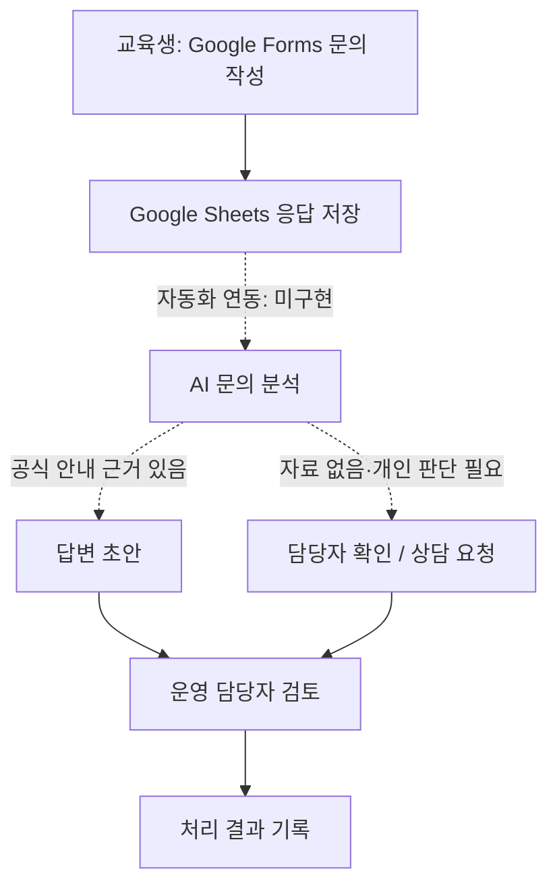

# AI 기반 기업교육 운영 문의 관리 서비스

> SKT ALEPH 개인 캡스톤 프로젝트 · 기획 / MVP 구현 / 검증 진행 중  
> 목표 완료일: **2026-11-12**

## 1. 프로젝트 소개

교육 과정에서 발생하는 일정, 과제, 프로젝트 및 상담 문의를 접수하고, AI가 문의 유형에 따라 **공식 자료 기반 답변 초안 / 담당자 확인 필요 / 개별 상담**으로 분류하는 교육 운영 지원 서비스입니다. AI가 최종 답변을 임의로 확정하지 않고 담당자가 검토하는 흐름을 지향합니다.

**현재 상태:** 기획 및 초기 기능 테스트 완료, Google Forms–Sheets 접수 경로 연결 설정 확인. 실제 폼 제출 후 자동 저장 검증과 AI 자동화 연동은 아직 완료되지 않았습니다.

## 2. 문제 정의와 근거

실제 교육 환경에서 다음 문의가 관찰되었습니다.

- 프로젝트 기간 및 교육 일정에 대한 문의
- 프로젝트 주제, 구성 및 최종 프로젝트 진행 방식에 관한 문의
- 개인 출결 확인 및 개별 상담 요청
- 일정표·공지 확인 후 안내하거나 강사가 수업 중 구두로 안내하는 방식

비슷한 질문이 반복되는 사례는 관찰했지만, **교육 운영 담당자의 업무 부담이나 실제 시간 절감 효과는 아직 검증하지 못했습니다.** 공식 홈페이지·플랫폼, 단체 채팅방, 구두 설명 등 정보 출처가 서로 다르다는 점을 고려해, 자료에 근거가 없을 때는 확인 요청으로 처리하도록 설계했습니다.

자세한 내용: [문제 정의와 검증 상태](docs/01_problem_evidence.md)

## 3. 핵심 기능

| 기능 | 상태 | 비고 |
|---|---|---|
| 문의 유형 분류 규칙 | 설계 완료 | 공통 안내 / 정보 확인 필요 / 개별 상담 / 권한 확인 문의 |
| ChatGPT 수동 분류 테스트 | **3건 통과** | 가상 문의 3건, 수동 프롬프트 시험만 수행 |
| Google Forms 문의 접수 양식 | 설정 완료 | 가상 데이터용 |
| Google Sheets 응답 시트 연결 | 설정 확인 | 자동 저장은 제출 테스트로 재검증 예정 |
| 문의 자동 분류·초안 생성 연동 | 미구현 | 우선 구현 목표 |
| 담당자 검토·처리 상태 관리 | 데이터 구조 설계 | 실제 운영 프로세스 검증 전 |
| AI 도구 호출형 에이전트 | 검토 중 | 구현한 경우에만 완료 표기 |
| 공지문 조회/RAG | 검토 중 | 공식 자료 접근권한·범위 확인 필요 |

## 4. 서비스 흐름

**현재 구성 및 계획의 구분**

- **실선:** 접수/저장 경로의 연결은 설정되어 있으며, 실제 제출 테스트는 미완료
- **점선 이후:** 구현 예정인 기능 흐름

## 5. 사용 도구

- Google Forms: 문의 입력 화면
- Google Sheets: 응답 및 처리 상태 관리
- ChatGPT: 초기 분류 규칙과 수동 기능 테스트
- 자동화 도구/API: **미선정·미연동**

## 6. 검증 현황

초기 가상 문의 3건의 기대 분류와 ChatGPT의 실제 분류가 일치했습니다(**3/3**). 이는 제한된 예시에서의 기능 확인으로, 실제 사용자 기준 정확도나 업무 시간 절감 효과를 뜻하지 않습니다.

- [초기 테스트 케이스](tests/test_cases.csv)
- [테스트 실행 기록](tests/test_runs.csv)
- [향후 검증 계획](docs/05_validation_plan.md)

## 7. 산출물 안내

| 영역 | 자료 |
|---|---|
| 문제·고객 | [문제 정의](docs/01_problem_evidence.md) |
| 기능·요구사항 | [요구사항](docs/02_requirements.md) |
| 설계 | [서비스 흐름](docs/03_service_flow.md), [AI 처리 규칙](docs/04_ai_rules.md) |
| 테스트·검증 | [검증 계획](docs/05_validation_plan.md), [시험 기록](tests/test_runs.csv) |
| 시장·사업 | [경쟁/사업화 검토](docs/06_market_business.md) |
| 결정·변경 | [의사결정 로그](docs/07_decision_log.md), [진행 로그](docs/09_progress_log.md) |
| 운영·인계 | [운영 안내](docs/08_operations.md) |
| 발표 | [발표 구성](presentation/presentation_outline.md) |
| 구현 자료 | [automation 안내](automation/README.md) |
| 증거 캡처 | [evidence 안내](evidence/README.md) |

## 8. 개발 및 실행 방법

현재는 **Google Forms / Sheets를 사용하는 노코드 프로토타입**이며, 독립 실행 가능한 코드나 배포된 웹앱은 없습니다.

1. Google Forms에서 `AI 교육운영 문의 접수` 양식을 만듭니다.
2. 질문 `문의 내용`을 장문형·필수로 설정합니다.
3. 응답 대상을 Google Sheets 파일 `AI_교육운영_문의관리_MVP`에 연결합니다.
4. 가상 문의를 제출해 응답 시트 저장 여부를 확인합니다. (**테스트 예정**)
5. AI 자동화 연동 후에는 이 절차를 실제 구성에 맞게 개정합니다.

## 9. 프로젝트 역할과 기여

개인 프로젝트로 문제 사례 정리, 처리 규칙 설계, 초기 AI 분류 테스트, Google Forms/Sheets 구성 작업을 진행했습니다. 생성형 AI의 도움을 받아 문서와 프롬프트 초안을 작성하고 수정했습니다. 다른 사람이 수행한 업무나 향후 구현 예정 기능을 개인 실적으로 포함하지 않습니다.

## 10. 개인정보 및 공개 범위

- 이 저장소에는 **가상 교육 문의 데이터만** 공개합니다.
- 실제 교육생 이름, 연락처, 출결 정보, 상담 기록은 업로드하지 않습니다.
- 학원 내부 공지·교육자료 및 캡스톤 가이드 원본은 공유 허가 없이 공개하지 않습니다.
- API 키, 비밀번호, 토큰은 커밋하지 않습니다.
- 스크린샷은 개인정보와 개인 계정 정보를 제거한 후 게시합니다.

## 11. 남은 일정

- 10/28~10/29: Forms 제출 → Sheets 저장 확인
- 10/30~11/03: AI 분류 및 초안 자동화 구현
- 11/04~11/06: 담당자 검토 및 처리 흐름 완성
- 11/07~11/09: 기능 테스트·개선·실측
- 11/10~11/12: PPT 발표·시연·포트폴리오 PDF 정리

※ 일정은 목표이며 실제 완료 여부는 [진행 로그](docs/09_progress_log.md)에 기록합니다.
