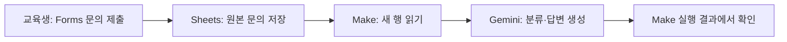
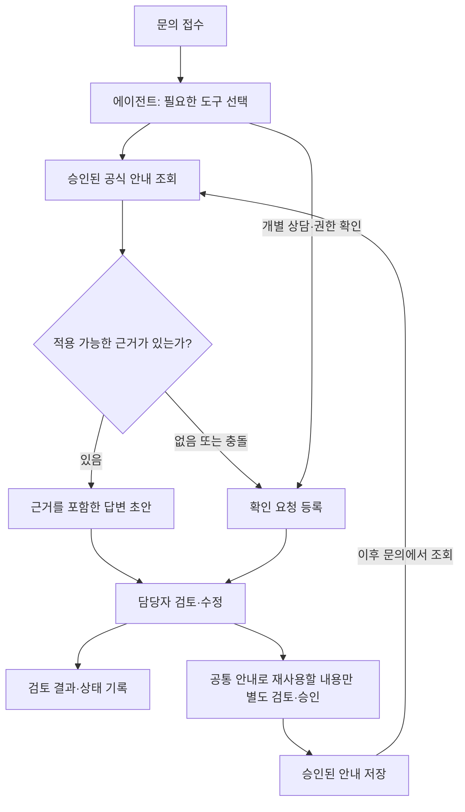

# 모아(MOA)

**AI 기반 기업교육 운영 문의 관리 서비스**

> 문의를 모으고, 답변할 일과 확인할 일을 구분합니다.

## 최신 개발 현황 | 2026-11-05 검증 기준

- **검증 완료:** Make AI Agent의 승인 안내 조회 및 담당자 확인 요청 도구 호출
- **검증 완료:** 가상 자료 MOA-G003 승인 전후 처리 변화 및 승인된 안내 원문 재조회
- **개선 확인:** 근거 없는 메뉴 안내 오류를 수정하고 특정 사례 재시험
- **진행 중:** 신규 Forms 문의와 AI 에이전트 연결, 처리 결과 통합 저장
- **미구현:** T13 운영자 콘솔과 실시간 AI 데이터 연동
- **운영 원칙:** 가상 데이터 사용, 사람의 최종 승인, 자동 실행 Inactive
- **최종 준비 마감:** 2026-11-11 오후 6시

[최신 AI 에이전트 통합 개발 기록](docs/12_agent_integration_progress_20261105.md)

아래는 2026-10-28 당시의 개발 현황을 보존한 기록이다. 현재 상태는 위 최신 기록을 우선한다.

---

## 이전 개발 기록 | 2026-10-28

SKT ALEPH 개인 캡스톤 · 서비스 기획 / MVP 구현 / 검증 진행 중  
기록 기준일: **2026-10-28** · 목표 완료일: **2026-11-12**

**현재 확인한 동작:** Google Forms 문의 제출 → Google Sheets 저장 → Make에서 문의 읽기 → Gemini의 분류·답변 생성.

**다음 구현 목표:** AI 결과 저장, 도구 호출형 에이전트, 담당자 검토·승인, 승인된 공통 안내 재사용. 현재 동작은 정해진 순서의 AI 자동화이며, 에이전트 구현 완료를 뜻하지 않습니다. 정기 자동 실행은 켜지 않고 수동 실행으로 시험하고 있습니다.

## 1. 프로젝트 소개

모아는 교육 운영자가 일정·과제·프로젝트·상담 문의를 구분하고 처리하도록 돕기 위해 개발 중인 서비스입니다. 공식 안내에 근거한 답변 초안을 작성하거나, 자료가 없고 개인별 판단이 필요한 문의를 사람의 확인 대상으로 구분합니다.

이 프로젝트의 핵심 설계 질문은 **“AI가 답을 모를 때, 담당자의 확인과 다음 문의 대응을 어떻게 연결할 것인가?”**입니다.

단순 답변 생성을 넘어 `근거 조회 → 확인 요청 → 사람의 검토·승인 → 다음 문의에 재사용`하는 업무 흐름을 구현하는 것이 목표입니다. 사람의 개별 상담 내용이나 개인정보를 자동으로 공통 안내에 포함하지 않습니다.

핵심 사용자는 교육 운영 담당자이며, 교육생은 문의를 제출하고 강사는 상담·세부 안내 확인에 참여하는 역할로 설정했습니다. 이 역할 구분과 서비스의 유용성은 검증이 필요한 설계 가설입니다.

## 2. 문제 정의와 근거

작성자가 교육을 수강하면서 일정과 프로젝트 진행 방식에 대한 비슷한 질문이 반복되는 모습을 관찰했습니다. 프로젝트 구성 상담과 개인 출결 확인 문의도 관찰했습니다. 일정표·공지를 확인해 답변하는 경우가 있으며, 공식 자료에 없는 세부 내용은 강사의 구두 설명으로 안내됩니다.

| 구분 | 현재 확인한 내용 |
|---|---|
| 관찰한 사실 | 일정·프로젝트 관련 반복 질문, 문서와 구두 안내의 병행, 개인별 상담 요청 |
| 문제 가설 | 답변 근거와 문의 성격을 구분하고 확인 결과를 관리하면 담당자의 처리를 지원할 수 있음 |
| 아직 미확인 | 담당자의 업무 부담, 문의당 처리 시간, 서비스 도입 의사, 지불 의사 |
| 조사 한계 | 운영 담당자 인터뷰는 진행하지 못함. 교육생 관찰을 운영자의 요구사항 검증으로 대체하지 않음 |

여러 경로로 안내된다는 사실만으로 교육생이 정보를 찾기 어렵다거나 운영 업무가 비효율적이라고 단정하지 않습니다. 공지·FAQ 정리, 문의 유형 직접 선택과 수동 처리, AI 처리 지원을 비교 대상으로 검토합니다.

자세한 내용: [문제 정의와 검증 상태](docs/01_problem_evidence.md)

## 3. 핵심 기능과 구현 상태

| 기능 | 상태 | 확인 범위 및 남은 작업 |
|---|---|---|
| 문의 처리 규칙 | 초안 작성·일부 시험 | 공통 안내 / 정보 확인 필요 / 개별 상담 / 권한 확인 필요. 모든 유형의 연동 시험을 마친 것은 아님 |
| Forms 문의 접수·Sheets 저장 | 동작 확인 | 가상 문의 1건의 본문과 제출 시각 저장 확인 |
| Make에서 문의 읽기 | 동작 확인 | Watch New Rows의 출력에서 문의 내용 확인 |
| Gemini 분류·답변 생성 | 연동 확인·품질 개선 필요 | 상담 문의에서 개별 상담 분류 확인. 요약에 관련 없는 안내가 섞이는 문제 발견 |
| AI 결과의 관리 시트 저장 | 설정 중 | Add a Row 모듈 추가. 저장 성공은 아직 확인하지 않음 |
| 도구 호출형 AI 에이전트 | 핵심 구현 목표·미구현 | 공식 안내 조회와 확인·상담 요청 등록 도구를 실제로 선택·실행하는 구조 |
| 승인된 공통 안내 재사용 | 구현 목표·미구현 | 사람의 승인 및 과정·기수·적용 기간을 확인한 자료만 조회 |
| 담당자 검토·수정·상태 관리 | 데이터 구조 초안·연동 미구현 | 원문, AI 초안, 근거, 담당자 수정 결과를 구분해 기록 |
| 운영자 전용 화면 | 설계·구현 예정 | 문의 목록과 상세 검토 흐름부터 구성 |

**에이전트의 최소 범위:** 공식 안내를 읽는 도구 1개와 내부 확인·상담 요청을 등록하는 도구 1개입니다. AI가 “등록했다”고 응답하는 것만으로 성공 처리하지 않고, 도구 반환값과 실제 저장 기록을 함께 확인합니다. 공식 안내 승인과 외부 답변 발송 권한은 에이전트에 주지 않는 방향으로 설계합니다.

멀티 에이전트, MCP, XDR, 회원가입·결제, 외부 메시지 자동 발송은 현재 핵심 범위에 포함하지 않습니다.

## 4. 서비스 흐름

### 현재 동작을 확인한 범위

Gemini에는 가상 공식 안내자료를 시스템 프롬프트로 제공합니다. 실제 공식 문서 검색이나 에이전트의 도구 선택은 아직 구현하지 않았습니다. AI 결과 저장과 사람의 검토는 위 흐름의 완료 범위에 포함하지 않습니다.

### 목표 업무 흐름 — 아직 미구현

구두로 들은 내용을 AI가 공식 정책으로 확정하지 않습니다. 승인된 안내 재사용은 자료를 저장·조회하는 기능이며, 모델을 재학습시키는 기능이 아닙니다. 상담 기록은 자동으로 공통 안내로 전환하지 않습니다.

## 5. 사용 도구

| 도구 | 현재 사용 범위 |
|---|---|
| Google Forms | 가상 문의 입력 |
| Google Sheets | 원본 문의 저장, 관리 항목 구성 |
| Make | 새 행 조회, Gemini 호출, 결과 저장 모듈 설정 |
| Google Gemini API | 프롬프트에 제공한 가상 안내자료로 분류·답변 생성 |
| ChatGPT | 기획·문서·프롬프트 작성 지원, 초기 수동 분류 시험 |
| GitHub | 문서·테스트·발표 자료의 변경 이력 관리 |

에이전트 실행 방식과 운영자 화면 도구는 사용 가능한 기능·권한·비용을 확인한 뒤 확정합니다. 아직 사용하지 않은 도구나 RAG·MCP·Memory를 구현 기술로 표기하지 않습니다.

## 6. 검증 현황

| 시험 | 관찰된 결과 | 해석과 한계 |
|---|---|---|
| ChatGPT 수동 분류 | 가상 문의 3건 중 기대 분류 3건 일치 (**3/3**) | 초기 예시 시험. 실제 서비스 정확도가 아님 |
| Forms → Sheets 저장 | 가상 문의 1건 저장 확인 (**1/1**, 2026-10-28) | 원본 문의와 제출 시각 저장 기능 확인 |
| Sheets → Make 읽기 | 실행 결과에 문의 내용 출력 | 데이터 조회 성공. 이 단계만으로 AI 실행 성공을 뜻하지 않음 |
| Make → Gemini 연동 | 상담 문의 시험에서 응답 생성 및 ‘개별 상담’ 분류 확인 | 연동은 성공했으나 답변의 관련성은 개선 필요 |

### 발견한 문제와 개선 계획

프로젝트 구성 상담 요청 시험에서 AI 답변에 “최종 프로젝트의 세부 진행 방식이 공식 문서에 없다”는 내용이 함께 출력됐습니다. **분류 일치와 답변 내용의 적절성을 별도로 평가해야 한다는 문제**를 확인했습니다.

원인은 아직 확정하지 않았습니다. 실제 전달된 문의와 프롬프트를 확인한 뒤, 상담 요약에 관련 없는 안내를 포함하지 않도록 처리 기준을 보완하고 재시험할 계획입니다. 수정 및 재시험 완료를 뜻하지 않습니다.

### 후속 검증 계획

가상 문의 **20건을 평가 세트의 목표**로 설정합니다. 정상 안내, 근거 없음, 상담, 권한 확인, 만료·상충 안내, 규칙 변경 지시, 도구 오류를 포함하고 실행 전에 기대 행동과 통과 기준을 정합니다. 아직 20건을 시험한 것은 아닙니다.

수동 처리, 현재 단일 모델 호출, 도구 호출형 에이전트를 비교하되 분류 일치, 답변 적절성, 실제 도구 실행, 수정 필요 여부, 사람의 검토까지 포함한 시간과 사용량을 구분해 측정합니다. 모델·자료·질문 조건이 다른 비교는 그 한계를 기록합니다. 교육생 사용성 시험, 운영자 역할의 모의 시험, 실제 운영 담당자 검증도 구분합니다.

**실제 업무 시간 절감률, 운영 환경의 정확도, 도입 효과는 아직 측정하지 않았습니다.**

- [초기 테스트 케이스](tests/test_cases.csv)
- [테스트 실행 기록](tests/test_runs.csv)
- [검증 계획](docs/05_validation_plan.md)

Make·Gemini 후속 시험은 실행 화면으로 확인한 내용이며, 해당 CSV 행과 공개용 증거 파일의 정리는 남아 있습니다. README 갱신만으로 상세 시험 기록이 갱신되는 것은 아닙니다.

<!-- MOA-VALIDATION-20261030-BEGIN -->
### 미처리 문의 재처리 및 공식 근거 준수 개선

- **자동화 연동 확인:** Google Forms → Sheets → Make → Gemini → JSON → 관리 시트 Add a Row까지 실행 성공. 가상 프로젝트 진행 방식 문의 `MOA-4` 저장을 확인했다.
- **재처리 기능 확인:** 누락이 의심된 과제 제출 문의 `MOA-3`을 관리 시트에 `재처리 대기`로 등록한 후, `MOA - Retry Pending Inquiries`에서 `Search Rows → Gemini → Parse JSON → Update a Row`로 기존 6행에 결과를 저장했다. 새로운 중복 행은 관찰되지 않았다. 원래 누락된 원인은 아직 규명하지 못했다.
- **AI 품질 문제와 개선:** 초기 답변은 가상 공식 자료에 없는 '학습 관리', '내 강의실', '과제 탭'을 안내했다(실패). Gemini의 공식 근거 준수 규칙을 강화한 후 동일 가상 문의 1건의 재시험에서는 '과제 제출' 메뉴만 안내하고 공식 근거를 명시했다(통과).
- **한계:** 작은 수의 가상 기능시험이며 실제 서비스 정확도나 운영자의 업무 효율 개선을 입증하지 않는다. 도구 선택형 AI 에이전트, 운영자 승인·공통 안내 재사용은 향후 구현 목표다.

[자세한 실행·재시험 기록](docs/11_retry_and_grounding_validation_20261030.md)

**발표 자료:** [MOA 발표자료 v0.2](presentation/MOA_발표자료_v0.2_검증추가.pptx)
<!-- MOA-VALIDATION-20261030-END -->

## 7. 산출물 안내

| 영역 | 자료 |
|---|---|
| 문제·고객 | [문제 정의](docs/01_problem_evidence.md) |
| 기능·요구사항 | [요구사항](docs/02_requirements.md) |
| 설계 | [서비스 흐름](docs/03_service_flow.md), [AI 처리 규칙](docs/04_ai_rules.md) |
| 테스트·검증 | [검증 계획](docs/05_validation_plan.md), [시험 기록](tests/test_runs.csv) |
| 시장·사업 | [경쟁/사업화 검토](docs/06_market_business.md) |
| 결정·변경 | [의사결정 로그](docs/07_decision_log.md), [진행 로그](docs/09_progress_log.md) |
| 운영·인계 | [운영 안내](docs/08_operations.md) |
| 발표 | [발표 구성](presentation/presentation_outline.md), [PPT 초안 v0.1](presentation/ai-education-inquiry-manager_presentation_v0.1.pptx) |
| 구현 자료 | [자동화 자료 안내](automation/README.md) |
| 시험 증거 | [실행 화면 관리 안내](evidence/README.md) |

문서와 PPT는 중간 산출물입니다. 에이전트 방향을 반영한 기능 명세·시험 기록·발표 자료는 구현과 함께 갱신합니다. 발표용 화면 설계와 실제 작동 화면은 구분합니다. 포트폴리오 PDF와 최종 발표 자료는 아직 완성하지 않았습니다.

신규 개발 방향 문서 `docs/10_portfolio_direction.md`는 업로드 준비 상태이며, 저장소 반영 여부는 별도로 확인합니다.

## 8. 현재 구성과 시험 방법

현재는 Forms·Sheets·Make·Gemini를 연결한 프로토타입입니다. 배포된 독립 웹앱이나 저장소만 내려받아 즉시 실행할 수 있는 패키지는 없습니다.

| 구성 요소 | 현재 설정 |
|---|---|
| 문의 입력 | Google Forms: `AI 교육운영 문의 접수` |
| 스프레드시트 | `AI_교육운영_문의관리_MVP` |
| 원본 응답 탭 | `설문지 응답 시트1`: 타임스탬프 / 문의 내용 |
| 관리 결과 탭 | `시트1`: 문의ID / 문의내용 / AI 분류 / AI 작성 내용 / 판단 근거 / 처리 상태 / 담당자 검토 결과 |
| 첫 모듈 | Google Sheets — Watch New Rows |
| 두 번째 모듈 | Google Gemini AI — Generate a response |
| AI 입력 | User 메시지의 Text에 `문의 내용(B)` 연결, System Instructions에 처리 규칙과 가상 안내자료 제공 |
| 세 번째 모듈 | Google Sheets — Add a Row 추가 후 설정 중. 저장 성공 검증 전 |

확인한 범위의 시험 순서는 다음과 같습니다.

1. 가상 문의를 Forms로 제출하고 응답 시트에 새 행이 저장됐는지 확인합니다.
2. 저장한 Make 시나리오에서 `Run once`로 시험합니다.
3. Sheets 실행 결과의 문의 원문과 Gemini에 전달된 값을 확인합니다.
4. Gemini 출력의 분류, 처리 방법, 답변·요약, 판단 근거를 기대 결과와 비교합니다.

새로 읽을 행이 없었던 실행에서는 Gemini까지 진행되지 않았습니다. 재시험 시 입력 데이터와 처리 시작 위치를 확인하고, 결과 저장·요청 등록 기능이 추가된 뒤에는 같은 문의의 중복 처리를 함께 점검합니다.

API 키와 계정 연결은 각자의 환경에서 설정하며 저장소에 포함하지 않습니다. 재현용 자동화 설정과 세부 운영 매뉴얼은 정리 중입니다.

## 9. 프로젝트 역할과 기여

개인 프로젝트로 진행하며, 사용자 관찰·기능 선택·설정 실행·검수·시험 결과 해석을 기록합니다.

| 구분 | 수행 범위 |
|---|---|
| 직접 수행 | 교육 현장의 문의 사례 관찰, 서비스명·진행 방향 선택, 안내를 참고한 Forms·Sheets·Make·Gemini 설정, 가상 문의 제출, 실행 화면 확인, GitHub 문서 반영 |
| AI 지원 | 기능·우선순위 제안, 프롬프트·문서·발표 자료 초안 생성, 설정 방법 안내, 실행 결과 검토 지원 |
| 외부 도구·자료 | 플랫폼과 모델이 제공하는 기능을 활용. 참고 자료와 적용 범위는 관련 문서에 기록 |
| 향후 수행 | 에이전트 도구 및 승인 규칙 구현, 운영자 화면, 비교 시험, 개선·재시험 |

개인 프로젝트를 실제 기업 운영 경력이나 팀 협업 성과로 표현하지 않습니다. 현재 확인한 결과와 향후 목표를 구분하며, 서비스의 시장성이나 경쟁 우위가 입증됐다고 주장하지 않습니다.

## 10. 개인정보 및 공개 원칙

- 시험에는 가상 교육 문의와 가상 안내자료만 사용합니다. 실제 교육기관의 공식 정책으로 오해하지 않도록 표시합니다.
- 실제 교육생의 이름·연락처·출결·상담 기록과 허가받지 않은 내부 자료는 공개하지 않습니다.
- API 키·비밀번호·토큰·계정 인증 정보는 업로드하지 않습니다. 비공개 저장소에도 비밀키를 넣지 않습니다.
- 스크린샷과 자동화 설정을 공개하기 전에 계정 정보와 민감정보를 검토합니다.
- 실제 외부 답변 발송 기능은 연결하지 않았습니다. AI의 출력 문구만으로 상담 전달·요청 등록·발송 완료를 기록하지 않습니다.
- 승인·권한 통제는 앞으로 도구와 데이터 접근 조건으로 구현하고 시험할 대상입니다. 프롬프트 입력만으로 보안 검증을 완료했다고 표시하지 않습니다.

## 11. 남은 일정과 완료 기준

| 목표 기간 | 우선 작업 | 확인할 결과 |
|---|---|---|
| 10/28~10/30 | AI 결과 저장 완성, 현재 자동화 보존, 에이전트 구성 검토·첫 조회 도구 시험 | 원문과 AI 결과의 연결, 실제 도구 조회 결과 |
| 10/31~11/03 | 조회·요청 등록 도구 구현, 승인된 안내 조회 조건 적용 | 실제 도구 실행, 요청ID와 저장 내역 일치 |
| 11/04~11/06 | 운영자 검토 흐름과 최소 화면, 승인 안내 재사용 | 승인 전후 동작 차이, 사람이 수정·검토한 결과 |
| 11/07~11/09 | 비교 시험, 사용성 확인, 오류 수정·재시험 | 기대·실제 비교와 실패·개선 근거 |
| 11/10~11/12 | 최종 시연·PPT·포트폴리오·README 정합성 확인 | 설명과 실제 구현·검증 결과가 일치하는 제출물 |

이는 목표 일정이며 완료 실적이나 일정 보장이 아닙니다. 시간이 부족하면 부가 기능과 화면 장식을 줄이고, 핵심 업무 흐름·시험·개선 기록을 우선합니다. 에이전트나 승인 기능을 검증하지 못했다면 미완료로 표시합니다.

최종 산출물은 기능별로 **문제·가설 → 선택 이유 → 요구사항·정책 → 구현 → 시험 → 오류·개선**을 연결하는 것을 기준으로 합니다. 실제 진행 내용은 [진행 로그](docs/09_progress_log.md)에 누적합니다.
